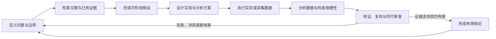

# AI 做科研，真正难的不是生成一个假设

让 AI 围绕一个研究问题提出十个假设，已经不难。

它可以迅速给出听起来新颖的机制、候选变量和实验方向，语言完整，逻辑顺滑，甚至像一份成熟的研究计划。但如果继续追问：这个想法是否早已发表？关键前提来自哪篇论文？怎样设计能够证伪它的实验？失败结果如何解释？分析代码能否复现？同一结论换一批样本是否仍然成立？

任务会立刻变得困难。


*原创配图：科研不是一次生成，而是文献、候选假设、实验、数据分析、验证与复现不断循环的证据闭环。*

AI 做科研真正困难的，不是产生一个像样的想法，而是把想法推进成一条**可以追溯、可以证伪、可以重复、能够经受外部检查的证据链**。

## 假设只是科研漏斗的入口

一项科学主张从出现到成立，通常需要经过多个不同性质的环节：

| 环节 | 核心问题 | 仅靠生成文本为什么不够 |
| --- | --- | --- |
| 问题定义 | 研究对象、变量和边界是否清楚 | 模糊问题会产生无法检验的宏大结论 |
| 文献定位 | 已知什么、争议什么、缺口在哪里 | 模型可能遗漏文献或把已有想法误判为新颖 |
| 假设形成 | 机制是否合理，预测是否具体 | 合理叙事不等于真实机制 |
| 实验设计 | 什么观察能够支持或推翻假设 | 缺少对照、样本和干预设计就无法归因 |
| 数据分析 | 处理流程和统计选择是否稳健 | 不同过滤、参数和指标可能得到不同结论 |
| 复现与评审 | 他人能否重复，边界是否被正确表达 | 一次成功和一张漂亮图不能证明普遍成立 |

因此，“AI 生成了一个新假设”和“AI 完成了一项科学发现”之间，隔着完整的研究过程。前者是候选的产生，后者至少还需要独立证据、实验或观测验证，以及对替代解释的排除。

## 科研需要的是闭环，而不是流水线终点

科研过程并不总是按直线前进。实验失败可能迫使人重新定义问题，数据分析可能暴露混杂变量，文献核查也可能证明所谓新想法早已有过系统研究。



AI 可以参与每个节点，但没有任何一个节点天然等于最终真理。闭环的价值在于，后续证据可以推翻前面的判断，并把失败重新送回问题定义和假设形成阶段。

## 第一难：判断“新颖”必须接回文献

大模型擅长重组知识，也因此容易生成“听起来新”的组合。问题是，新颖性不是语言属性，而是相对于已有研究的关系判断。

一个假设是否新颖，需要检查：相关机制是否已经提出，类似实验是否做过，已有结果是否相互矛盾，负结果是否存在，以及新方案究竟改变了哪个条件。没有检索和来源绑定，模型只能凭自身记忆判断，很容易把遗漏当成空白。

因此，AI 的新颖性评审至少应当输出：检索范围、最接近的已有工作、与已有工作的实质差异，以及尚未覆盖的来源。查不到证据只能说明当前检索没有找到，不能直接写成“从未有人研究”。

## 第二难：把叙事变成可以失败的预测

不容易失败的假设，也不容易被科学检验。

“某因素可能影响系统表现”几乎总能在结果出来后得到一种解释。更可检验的表达需要明确：改变什么变量，在什么对象和条件下，预计观察到什么方向或幅度的变化；如果没有出现，哪些解释将被削弱。

| 叙事式表达 | 可检验表达需要补什么 |
| --- | --- |
| 某方法可能改善结果 | 对照方法、评价指标、适用数据和预期差异 |
| 某机制可能导致异常 | 干预变量、观测变量、时间顺序和替代机制 |
| 某药物可能对疾病有效 | 生物模型、剂量、对照、终点和安全边界 |

AI 可以帮助把模糊想法拆成变量、预测和反例，但最终实验是否合理，仍需要领域知识、资源条件和伦理约束共同判断。

## 第三难：实验反馈不只是“成功或失败”

现实实验会产生大量中间状态：样本质量不足、仪器漂移、对照异常、统计功效不够、实验协议执行偏差，或者结果只在一个特定条件下成立。

如果 Agent 只接收一句“实验成功”，下一轮假设更新会丢失最重要的信息。更有价值的反馈包括原始数据、实验条件、排除记录、失败原因、分析参数和不确定性。

这也是为什么实验室在环比“全自动科研”的口号更准确。AI 可以加快候选生成、文献综合和数据分析，人仍需负责实验执行、异常判断、伦理审查和证据采用。

## 第四难：数据分析本身是一组选择

同一份数据可能经过不同的清洗、过滤、归一化、统计模型和可视化方式。每项选择都可能影响最终结论。

让 Agent 自动写出一段能运行的分析代码，并不等于分析已经可信。还需要记录：数据版本、排除规则、参数、随机种子、软件环境、中间产物和失败尝试；重要结论还应通过替代指标、敏感性分析或独立分析路径复核。

多条分析轨迹的意义也不是简单投票。如果多条轨迹使用了相同错误前提，它们会稳定地一起出错。真正有用的是保存可执行 notebook 或脚本，比较不同路径在哪些假设和参数上分叉，再由证据和领域规则判断。

## 三种看似完成、实际没有闭环的科研产物

### 1. 只有漂亮的机制故事

文章把若干文献线索连成一个完整机制，却没有给出来源对应关系，也没有说明哪些环节只是推测。这属于可读的研究构想，不是得到验证的结论。

### 2. 只有一个更高的基准分数

方法在某个数据集上超过基线，但没有固定数据切分、消除泄漏、做多次运行或分析适用边界。它证明的是一次配置下的分数，不自动等于新的科学规律。

### 3. 只有一次阳性实验

单次实验得到预期方向，却缺少独立重复、替代对照和失败样本。它可以作为继续研究的信号，不能直接外推为稳定机制或实际应用效果。

## 人和 AI 应该怎样分工

| 工作 | AI 更适合承担 | 人必须保留的责任 |
| --- | --- | --- |
| 文献检索 | 扩大检索、聚类主题、整理证据卡片 | 判断来源权威、检索缺口与争议 |
| 假设生成 | 组合跨领域线索、提出多个候选 | 决定问题价值、机制合理性与风险 |
| 实验设计 | 枚举变量、对照、失败条件和分析计划 | 资源、伦理、实验可行性与最终审批 |
| 数据分析 | 执行重复流程、生成代码、探索替代分析 | 判断异常、统计口径与结论强度 |
| 写作表达 | 组织结构、生成图表和初稿 | 保证事实、署名、责任和证据边界 |

最健康的关系不是 AI 取代科学家，而是 AI 扩大候选空间和执行能力，人负责研究方向、证据门槛与最终责任。

## 一个最小可复现研究包

如果 AI 真正参与了科研工作，最终交付不应只有一份结论摘要。一个最小研究包至少包括：

```text
研究问题：对象、范围、变量和排除项。
证据表：每项关键主张对应的来源与核验状态。
假设卡：机制、预测、反例和替代解释。
实验记录：协议版本、样本、对照、偏差和失败情况。
分析产物：原始数据引用、代码、参数、环境与中间结果。
结论边界：当前证据支持什么，不能推出什么。
复现入口：他人如何重新运行、检查或重复实验。
```

这个研究包不会保证结论一定正确，却能让错误更容易被发现，也让后续研究可以从真实状态继续，而不是从一段无法追溯的聊天记录重新开始。

## 使用 AI 做科研前的 30 秒检查

- 研究问题是否足够具体，哪些范围明确不讨论？
- 所谓新颖性是否经过文献检索，而不是由模型自行声明？
- 每个关键前提能否回到论文、数据或实验记录？
- 假设是否给出了可以失败的预测和替代解释？
- 实验是否包含必要的对照、重复和停止条件？
- 数据分析的版本、参数、排除规则和环境是否可复现？
- 阳性结果是否经过替代分析或独立重复？
- 负结果和失败过程是否被保存，而不是从报告中删除？
- 人类专家在哪些节点拥有否决权，并对最终结论负责？

AI 可以让科研更快地产生候选、连接文献和执行分析。但科研的价值从来不在于产生最多的想法，而在于用证据不断淘汰错误、缩小不确定性。

真正值得追求的不是“AI 想出了什么”，而是：**这个想法经过了什么检验，我们现在究竟有理由相信到哪一步。**

## 延伸阅读

- Juraj Gottweis 等：[Accelerating scientific discovery with Co-Scientist](https://doi.org/10.1038/s41586-026-10644-y)。
- Ali Essam Ghareeb 等：[Towards an AI co-scientist: multi-agent scientific discovery](https://doi.org/10.1038/s41586-026-10652-y)。

---

[上一篇：Open-Open-Reasoning 在做什么](/ai-work/ai-work-open-open-reasoning/) · [系列目录](/ai-work/ai-work-series/) · [下一篇：数据库为什么需要变得 Agent-Friendly？](/ai-work/ai-work-12-agent-friendly-database/)
