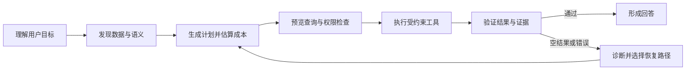

# 数据库为什么需要变得 Agent-Friendly

给 Agent 一个数据库连接、一份 schema 和执行 SQL 的工具，它就能可靠地回答数据问题了吗？

很多失败并不是 Agent 不会写 SQL，而是它不知道某个字段的业务含义，不清楚单位和时区，无法判断两个系统里的客户编号是否指向同一实体，也不知道空结果来自“确实没有数据”还是“查询条件写错了”。即使最终数字正确，它也可能使用了过期快照、扫描了不该读取的数据，或者无法说明结论来自哪些记录。


*原创配图：Agent-Friendly 数据库不仅提供查询入口，还显式提供语义关系、权限门禁、证据验证、状态观察和失败恢复路径。*

Agent-Friendly 不是在数据库前面加一个聊天框，而是让数据系统能够向机器清楚表达：**有什么数据、这些数据是什么意思、允许怎样操作、结果如何验证，以及失败后应该怎样安全恢复。**

## 对人友好，不自动等于对 Agent 友好

人类数据工程师遇到陌生表时，会阅读文档、询问同事、抽样查看数据，并根据经验补齐大量隐含背景。Agent 没有这些默认知识，只能依赖系统显式提供的描述和工具反馈。

| 面向人的传统设计 | Agent 还需要什么 |
| --- | --- |
| 表名、列名和数据类型 | 业务定义、实体关系、单位、时区和口径 |
| 一个通用 SQL 入口 | 可发现、受约束、可组合的专用工具 |
| 返回结果集或错误字符串 | 结构化证据、来源、状态和可行动错误 |
| 靠工程师理解权限规则 | 机器可读的允许动作、范围、预算和确认点 |
| 靠经验处理空结果和异常 | 明确的诊断、重试、替代路径和停止条件 |

所谓 Agent-Friendly，本质上是把过去藏在人脑、文档和组织经验中的接口契约，变成机器能够读取和执行的系统能力。

## 第一层：让 Agent 能发现数据，也能理解语义

Schema 只告诉 Agent 一列叫 `value`，类型是浮点数，却不会自动说明它是摄氏温度、瞬时功率还是累计流量。`created_at` 也可能是事件发生时间、数据入库时间或记录更新时间。

一个可用的语义层至少应表达：

- 表、字段和实体之间的关系；
- 指标定义、单位、时区、采样频率和聚合规则；
- 缺失值、异常值和迟到数据怎样处理；
- 数据版本、更新时间和适用范围；
- 公司内部概念和业务口径，例如“活跃用户”的具体定义。

语义层的目的不是替 Agent 做完推理，而是避免它在错误口径上进行一段逻辑完美的计算。

## 第二层：把数据库能力拆成可约束的工具

只提供一个“执行任意 SQL”工具，权限很大，反馈却很少。更适合 Agent 的接口可以按动作拆开：



一组更清楚的工具可能包括：

- `list_sources`：发现当前可访问的数据源；
- `describe_entity`：读取字段、关系、指标和样例；
- `preview_query`：检查扫描范围、权限和预期成本；
- `execute_query`：执行只读或明确授权的操作；
- `verify_result`：复算关键指标、检查行数和数据快照；
- `recover_query`：根据结构化错误生成安全替代路径。

工具拆分不是为了增加调用次数，而是给关键动作设置检查点。高风险写操作还需要幂等键、事务、确认和回读，防止网络重试产生重复修改。

## 第三层：给 Agent 提供领域原语

SQL 擅长过滤、连接和聚合，却不适合表达所有数据任务。

例如，“找出过去一年中温度先快速上升、随后维持平台的时间段”，包含连续形态、相对速度和局部分布。把“快速”硬编码成某个固定斜率，可能在不同设备和季节下完全失效。

更合理的方式是先用数据库中的索引和统计特征搜索候选窗口，再在原始信号上用时序算子精确验证。这种“先搜索、后验证”的分工说明，Agent-Friendly 数据库不仅要暴露底层记录，还应提供适合领域任务的操作把手。

| 数据问题 | 可能需要的专用原语 |
| --- | --- |
| 自由文本中的日期、实体和类别 | 日期解析、实体识别、结构化抽取 |
| 时序趋势、周期和异常窗口 | 趋势、变点、相似片段、周期检测 |
| 跨库脏连接键 | 标准化、模糊匹配、实体解析 |
| 大规模聚合与比较 | 聚合下推、分区统计、近似预览 |

如果系统只给 Agent SQL 和一个通用编程环境，Agent 会重复实现这些操作，也更容易在正则、边界条件和数据规模上犯错。把稳定能力封装成受测试的原语，能让模型把注意力放在计划和解释上。

## 第四层：结果必须自带证据

对人类用户来说，一个数字常常已经像答案；对 Agent 系统来说，它还需要说明这个数字怎样得到。

一份可审计的查询结果可以同时返回：数据快照、查询或执行计划、涉及的表和字段、时间范围、扫描规模、过滤条件、聚合口径、验证器结果，以及关键记录或证据包的位置。

这样做有三个好处：

1. Agent 能在回答前自查单位、范围和空结果。
2. 人可以判断结论是否使用了正确数据，而不只看语言解释。
3. 同一问题可以在固定快照上重放，区分数据变化和模型变化。

证据不等于把全部数据库内容塞进上下文。系统应该返回紧凑摘要和稳定引用，需要时再按引用读取原始片段。

## 第五层：错误必须可以行动

传统数据库错误常面向工程师设计。Agent 收到一大段异常文本后，可能盲目改写查询，也可能重复执行同一个失败动作。

更适合 Agent 的错误应当结构化表达：错误类型、失败阶段、是否可重试、建议动作、剩余预算和当前状态。例如，明确区分：

- 字段不存在，需要重新发现 schema；
- 权限不足，应停止并请求授权；
- 扫描预算超限，应缩小时间范围或先做预览；
- 空结果已被验证，可能需要澄清用户意图；
- 查询语法失败，可以在不改变业务口径的前提下修复；
- 外部写入状态不明，必须先回读，不能直接重试。

恢复能力不意味着 Agent 永远给出答案。有时最正确的行为是停止，并清楚说明缺少什么数据、权限或业务定义。

## 一个最小的 Agent 数据契约

Agent-Friendly 不要求一开始建设庞大的平台。可以先为关键任务提供一份最小契约：

```yaml
data_contract:
  source: 数据源与固定快照
  entities: 实体、关系与主键
  freshness: 更新时间与适用范围

metric_contract:
  definition: 指标的业务定义
  unit: 单位与时区
  aggregation: 聚合、对齐和缺失值规则

tool_contract:
  allowed_actions: 允许的读取、预览、执行和验证动作
  scope: 可访问对象与数据范围
  budget: 扫描量、调用次数和时间限制
  verify: 结果回读与证据要求
```

契约的作用，是把“Agent 算错了”和“系统没有说清楚”分开。没有明确契约，失败很难归因，也很难持续改进。

## Agent-Friendly 不是什么

第一，它不是取消 SQL。SQL 仍然是稳定、强大且可优化的执行语言，Agent-Friendly 做的是补充语义发现、领域原语和验证接口。

第二，它不是开放更多权限。相反，越方便机器行动，越需要最小权限、预算、预览、幂等和审计。

第三，它不是把所有数据放进模型上下文。Agent 应主动检索、逐步缩小范围，让数据库继续承担过滤、连接、聚合和存储。

第四，它不是保证 Agent 永远正确。专用语义层和工具能够降低部分错误，但规划、实现和领域判断仍需评测与人工监督。

## 一次数据问答的完整验收

假设用户问：“比较两组设备上月的异常率，并解释差异。”可靠的 Agent 不应直接生成一条大查询然后写结论，而应：

1. 确认“异常率”的指标定义、设备范围、时区和上月边界。
2. 发现两组设备对应的数据源和跨表关系。
3. 预览查询计划、扫描规模和权限。
4. 执行聚合，并把关键中间结果绑定到固定快照。
5. 检查缺失数据、样本量差异和异常定义是否一致。
6. 用替代计算或验证器复算关键数字。
7. 区分“观察到差异”和“已经证明原因”，避免把相关性写成因果。
8. 返回结论、证据、限制和可复现入口。

这时，数据库不只是被动存储，还是 Agent 的语义来源、执行环境和证据基础设施。

## 建设 Agent-Friendly 数据系统前的 30 秒检查

- Agent 能否发现自己有权访问哪些数据？
- 字段、指标、单位、时区和业务口径是否机器可读？
- 数据版本、更新时间和适用范围是否明确？
- 是否提供预览、成本估算和最小权限工具？
- 常见领域任务是否有受测试的专用原语？
- 查询结果能否绑定到来源、快照、计划和验证结果？
- 错误是否区分可重试、需澄清、需授权和必须停止？
- 写操作是否支持幂等、事务、确认和回读？
- 是否记录工具调用、状态变化、预算和恢复过程？
- 人类责任人能否检查并否决高风险操作？

未来的数据系统不仅要被应用程序调用，也会被能够规划、试探、修正和解释的 Agent 使用。接口的重点因此会从“能不能执行查询”扩展为“能不能让机器正确理解、受控行动并证明结果”。

真正的 Agent-Friendly，不是让 Agent 更自由，而是让它**更少猜测、更容易验证、更安全地失败**。

## 延伸阅读

- Zhao Tan 等：[Sonar-TS: Search-Then-Verify Natural Language Querying for Time Series Databases](https://arxiv.org/abs/2602.17001)。
- Ruiying Ma 等：[Can AI Agents Answer Your Data Questions? A Benchmark for Data Agents](https://arxiv.org/abs/2603.20576)。

---

[上一篇：AI 做科研，真正难的不是生成一个假设](/ai-work/ai-work-11-ai-science/) · [系列目录](/ai-work/ai-work-series/)
