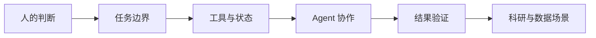

# 与 AI 一起工作｜系列目录

本系列不追逐“哪个模型又快了多少”，而是持续讨论一个更稳定的问题：当 AI 从生成答案走向调用工具、修改文件和参与决策，人应该怎样定义任务、授予权限、验证结果，并对最终选择负责？

当前发布版本以 [CSDN 专栏](https://blog.csdn.net/qq_44202160/category_13189602.html) 为准；本地第 10–12 篇尚未上线。

主线是：**保留人的判断 → 说清任务边界 → 理解 Agent 系统 → 建立验证方法 → 进入科研与数据场景**。

## 第一阶段：人怎样与 AI 协作

这一阶段先不讨论复杂架构，而是回答最常见的协作问题：人需要保留哪些判断，任务应该怎样表达，AI 的完成声明怎样核验，以及工具权限应该如何收束。

| 序号 | 文章 | 状态 | 解决的问题 |
| --- | --- | --- | --- |
| 1 | [我们需要的不是更快的 AI，而是更慢一点的判断](/ai-work/ai-work-slower-judgment/) | 已发布（CSDN） | 当答案越来越快，人为什么仍需在输入任务、采用结论和对外发布前主动停顿。 |
| 2 | [一个好的 Prompt，不是更长的命令，而是更清楚的任务边界](/ai-work/ai-work-prompt-boundaries/) | 已发布（CSDN） | 怎样把目标、范围、上下文、限制和验收条件组织成可执行、可审查的任务委托。 |
| 3 | [AI 说“完成了”，为什么你还不能相信它？](/ai-work/ai-work-03-completion-evidence/) | 已发布（CSDN） | 怎样区分“已经生成”“已经执行”“验证通过”和“真正实现目标”。 |
| 4 | [当 AI 可以修改文件和发送消息，权限应该怎样给？](/ai-work/ai-work-04-permission-gates/) | 已发布（CSDN） | 怎样为读取、修改、删除、写入外部系统和发送消息设置范围与确认点。 |

## 第二阶段：从生成答案到 Agent 系统

这一阶段解释 AI 如何连接外部世界、保持任务状态并进行协作，重点辨析容易混淆的系统概念，而不是罗列工具名称。

| 序号 | 文章 | 状态 | 解决的问题 |
| --- | --- | --- | --- |
| 5 | [MCP、Skills 与 Plugin：三者的层次与边界](/ai-work/ai-work-mcp-skills-plugin/) | 已发布（CSDN） | 怎样区分连接外部工具、封装工作流程和打包分发能力这三个层次。 |
| 6 | [上下文、记忆与知识库，不是同一回事](/ai-work/ai-work-06-context-memory/) | 已发布（CSDN） | 当前任务信息、跨任务状态和外部事实来源分别解决什么问题，又会怎样失效。 |
| 7 | [多 Agent，不是多开几个聊天窗口](/ai-work/ai-work-07-multi-agent/) | 已发布（CSDN） | 任务什么时候值得拆分，多个 Agent 如何分工、共享状态、处理冲突并合并结果。 |

## 第三阶段：怎样评价一个会行动的 AI

当 AI 开始调用工具，最终答案只是结果的一部分。还需要观察它经过了哪些状态、采取了哪些动作、产生了什么副作用，以及同一任务能否稳定复现。

| 序号 | 文章 | 状态 | 解决的问题 |
| --- | --- | --- | --- |
| 8 | [为什么评价 Agent 不能只看最终答案？](/ai-work/ai-work-08-agent-trajectory/) | 已发布（CSDN） | 为什么正确答案不能自动证明执行过程安全、稳定、可复现。 |
| 9 | [LLM-as-a-Judge 能不能给 AI 当裁判？](/ai-work/ai-work-09-llm-judge/) | 已发布（CSDN） | 大模型评委能够降低哪些成本，又会受到位置、措辞、自我偏好和评价尺度怎样的影响。 |
| 10 | [Open-Open-Reasoning 在做什么：Claude Thinking Signature 回放实验核查](/ai-work/ai-work-open-open-reasoning/) | 已成稿 | 怎样从仓库实现和实验现象出发，区分已经观察到的行为与尚未被证据支持的强结论。 |

## 第四阶段：AI 怎样进入科研与数据系统

这一阶段把前面的协作、系统和评测方法带入更专业的场景，讨论 AI 如何参与科学发现，以及数据系统为什么需要适应会规划、会调用工具的 Agent。

| 序号 | 文章 | 状态 | 解决的问题 |
| --- | --- | --- | --- |
| 11 | [AI 做科研，真正难的不是生成一个假设](/ai-work/ai-work-11-ai-science/) | 已成稿 | 怎样把文献检索、假设生成、数据分析、实验反馈和复现组织成一条证据闭环。 |
| 12 | [数据库为什么需要变得 Agent-Friendly？](/ai-work/ai-work-12-agent-friendly-database/) | 已成稿 | 面向 Agent 的数据系统为什么不仅要支持查询，还要表达语义、权限、状态和可恢复操作。 |

## 系列完成状态

当前 CSDN 专栏已发布第 1–9 篇；第 10–12 篇仍是本地成稿，尚未出现在该专栏。系列从日常人机协作出发，依次讨论任务边界、权限与状态、多 Agent 协作和 Agent 评测，并预留科研与数据系统专题。

## 阅读建议

- 如果刚开始使用 AI 工作，从第 1 篇读到第 4 篇，先建立任务边界、责任和验收意识。
- 如果正在搭建 Agent 或 AI 工具链，从第 5 篇继续阅读，重点理解连接、状态和多 Agent 协作。
- 如果关注 AI 评测、科研或数据系统，可以从第 8 篇进入，再阅读第四阶段的专题文章。

## 系列写作原则

每篇文章只解决一个核心问题，从具体场景或常见误解切入，先给出明确判断，再解释背后的机制。流程图和对照表用于承载信息，不以术语数量代替论证；涉及协议、产品能力和发布时间等可变事实时，以发表前核验的一手来源为准，并明确结论边界。
