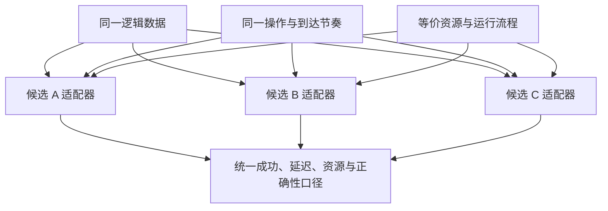
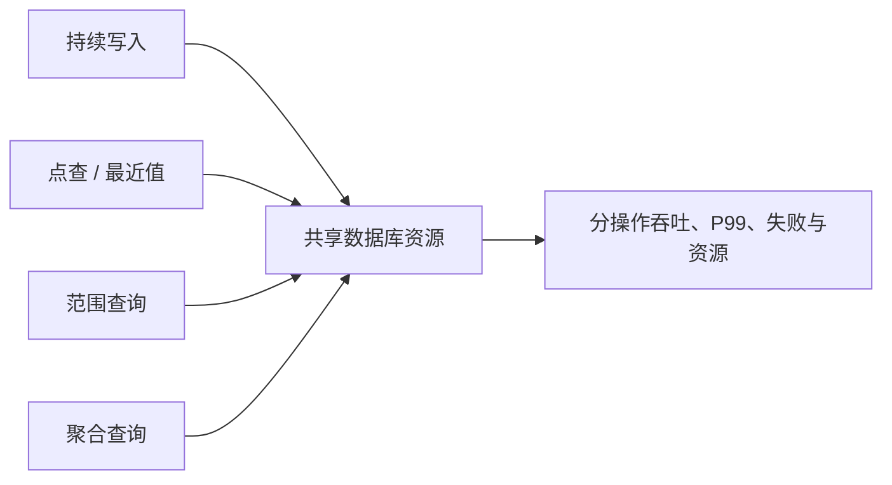

# 基准测试工具之你不知道的两三事 | 15. 端到端案例：如何完成一次时序数据库选型

前十四篇文章分别解决了一个局部问题：怎样构造负载、读懂波动、进行公平比较、验证正确性、测试集群并保存结果。到了真正的数据库选型现场，这些方法必须被组织成一条决策链。

选型不是寻找一个脱离场景的“最快数据库”，而是判断哪个候选在当前业务约束下更合适。最高吞吐量可能伴随不可接受的 P99、资源成本或正确性问题；功能最丰富的产品也可能让部署和运维成本超出团队能力。

这一篇以一个**假设的工业设备监测平台**为例，演示怎样用 IoT Benchmark 完成一次端到端选型。文中的候选 A、B、C、权重和表格都是方法示意，所有性能数据都应通过真实测试填写。

> 🏁 选型的最终产物不是一张总分榜，而是“在什么条件下，为什么选择谁，以及这个结论不覆盖什么”。

## 1. 从业务问题开始，而不是从跑分开始

假设平台持续接收设备遥测数据，同时提供最近状态、时间范围、聚合统计和告警查询。设备可能因网络中断产生乱序数据，系统未来还需要从单机扩展到集群。

第一步不是安装三个数据库，而是把业务事实补全：

| 业务维度 | 需要获得的真实输入 |
| --- | --- |
| 数据规模 | 当前与规划设备数、每设备测点数、数据类型。 |
| 写入节奏 | 正常速率、峰值阶段、批大小、持续时间。 |
| 乱序行为 | 乱序比例、延迟窗口、集中补写还是持续抖动。 |
| 查询行为 | 点查、范围、聚合、最近数据查询的比例和窗口。 |
| 服务目标 | 可接受 P99、失败率、数据可见时间和正确性要求。 |
| 保留与成本 | 数据保留周期、硬件预算、压缩和冷热分层要求。 |
| 运维约束 | 部署方式、团队经验、升级、备份、监控和故障处理。 |

这里不应凭经验填一个“典型值”。最可靠的来源是线上流量、查询日志、设备协议、容量规划和业务 SLA。暂时拿不到的数据应明确标为“待补”，并在结论中限制适用范围。


## 2. 先设置硬门槛，再讨论性能排名

有些要求不是用更高吞吐量可以补偿的。例如关键查询不支持、数据写入后无法正确读取、当前部署方式不符合安全要求，这些候选应先被标记为不满足，而不是进入加权平均。

| 硬门槛 | 通过条件 | 验证方式 | A | B | C |
| --- | --- | --- | --- | --- | --- |
| 必需写入和查询语义 | 待填 | 功能验证与独立查询 | 待测 | 待测 | 待测 |
| 数据正确性 | 数量、时间戳、类型和值无未解释差异 | 验证模式与抽样复核 | 待测 | 待测 | 待测 |
| 失败率和 P99 上限 | 待填 | 多轮目标负载测试 | 待测 | 待测 | 待测 |
| 部署与安全要求 | 待填 | 架构和配置审查 | 待测 | 待测 | 待测 |
| 备份恢复或高可用要求 | 待填 | 功能验证或独立演练 | 待测 | 待测 | 待测 |

未通过硬门槛的候选有两种处理方式：如果问题可以通过明确、可接受的配置修复，则固定修复方案后重测；如果属于能力缺失或成本不可接受，则退出当前场景的后续排名。

## 3. 缩小候选范围，但不要提前宣布冠军

进入性能测试前，可以先完成文档、许可、接口和部署条件审查，淘汰明显不符合要求的产品。此阶段的输出应是一张“候选适用性表”，而不是性能结论。

| 维度 | 候选 A | 候选 B | 候选 C | 证据 |
| --- | --- | --- | --- | --- |
| 所需写入接口 | 待核实 | 待核实 | 待核实 | 官方文档 / 实际验证 |
| 查询语义 | 待核实 | 待核实 | 待核实 | 官方文档 / 实际验证 |
| 单机与集群部署 | 待核实 | 待核实 | 待核实 | 官方文档 / PoC |
| 许可与成本 | 待核实 | 待核实 | 待核实 | 合同 / 许可文本 |
| 团队运维能力 | 待评估 | 待评估 | 待评估 | 内部能力盘点 |

文档宣称“支持”只能证明功能入口存在，不能替代当前版本和当前数据模型下的实际验证。

## 4. 建立统一的外部测试契约

不同数据库内部机制不同，无法要求所有参数完全一致。公平比较应统一对业务可见的条件：逻辑数据、操作语义、资源预算、运行过程和结果口径。



测试契约至少固定以下内容：

1. 同一设备、测点、数据类型、时间范围和预期值；
2. 同一写入节奏、批大小、并发和操作比例；
3. 同一查询语义，而不是只要求 SQL 文本相同；
4. 等价的 CPU、内存、磁盘、网络和节点数量；
5. 相同预热、正式运行、清理和重复规则；
6. 相同的正确性、P99、失败率和资源统计口径。

数据库特有优化可以使用，但必须记录。最好分别报告“默认推荐配置”和“经调优配置”，避免把一个产品的默认状态与另一个产品的深度调优状态混为一谈。

## 5. 第一关：用固定数据集验证正确性

正式压测前，为 A、B、C 使用同一份可重复数据集，按“生成数据 → 验证写入 → 验证查询”的流程检查数量、设备、时间戳、类型和值。

| 检查项 | 预期 | A | B | C |
| --- | --- | --- | --- | --- |
| 写入成功点数 | 待填 | 待测 | 待测 | 待测 |
| 实际设备、行和点数 | 与预期一致 | 待测 | 待测 | 待测 |
| 时间戳与字段定位 | 无差异 | 待测 | 待测 | 待测 |
| 类型与具体值 | 无差异 | 待测 | 待测 | 待测 |
| 点查、范围和聚合 | 与参考结果一致 | 待测 | 待测 | 待测 |

不能只看 Benchmark 汇总中的失败数。还应检查验证错误日志，并用独立查询抽样复核。任何未解释的数据差异都会让该轮性能数字失去比较资格。

## 6. 第二关：建立顺序纯写基线

正确性通过后，先运行最简单的顺序纯写工作负载。它的目标不是完成选型，而是建立每个候选的稳定基线，并确认发压端没有成为瓶颈。

| 场景 | 固定项 | 扫描项 | 主要观察 |
| --- | --- | --- | --- |
| 低压基线 | 数据模型、接口、批大小 | 无 | 结果能否稳定复现。 |
| 并发扫描 | 数据、批大小、写入节奏 | 客户端数 | 吞吐平台和 P99 拐点。 |
| 批大小扫描 | 数据、候选并发 | 批大小 | 请求开销与尾延迟平衡。 |

每个候选都应执行多轮，并同时记录吞吐量、平均延迟、P99、失败数、客户端资源和服务端资源。若候选之间结果范围高度重叠，应报告“当前场景未观察到稳定差异”，而不是按某一次最好成绩强行排名。

## 7. 第三关：恢复真实读写混合负载

纯写只覆盖采集路径，无法代表线上系统。接下来根据真实日志设置写入、点查、范围查询、聚合和最近数据查询的比例，并固定每类查询的设备数、测点数和时间窗口。



混合负载必须按操作类型报告结果。总吞吐更高，不代表关键告警查询的 P99 更低；写入表现更好，也不能掩盖范围查询失败。

| 操作 | 业务重要度 | 吞吐量 | P99 | 失败数 | 是否满足目标 |
| --- | --- | --- | --- | --- | --- |
| 写入 | 待填 | 待测 | 待测 | 待测 | 待判断 |
| 点查 / 最近值 | 待填 | 待测 | 待测 | 待测 | 待判断 |
| 范围查询 | 待填 | 待测 | 待测 | 待测 | 待判断 |
| 聚合查询 | 待填 | 待测 | 待测 | 待测 | 待判断 |

## 8. 第四关：加入乱序和峰值阶段

设备离线后的数据补写、网络抖动和不同链路延迟，会让到达顺序偏离事件时间顺序。应在固定总点数、并发、批大小和操作比例的前提下，分别测试顺序写与不同乱序形态。

乱序不能只写一个比例。还要说明旧数据落后多长时间、是在少量设备持续发生，还是在一批设备上集中出现。二者可能触发完全不同的存储行为。

对于高峰写入，也不能仅用一个固定频率代表完整过程。应按前文的“基线—峰值—恢复”阶段分别运行，并记录峰值后的积压、P99 和资源是否回到稳定范围。

| 阶段 | 到达节奏 | 乱序形态 | 观察重点 |
| --- | --- | --- | --- |
| 基线 | 业务常态，待填 | 待填 | 稳态吞吐和 P99。 |
| 峰值 | 峰值强度与持续时间，待填 | 待填 | 失败、排队和资源饱和。 |
| 恢复 | 回到基线 | 待填 | 积压是否消化、延迟是否恢复。 |

## 9. 第五关：从单机走向集群

如果目标部署包含集群，应在单机基线之后增加两类实验：固定总负载比较集群额外开销，以及随节点数增加负载观察扩展效率。

使用多个 Benchmark 实例时，为每个实例设置不同的 `BENCHMARK_INDEX`，让设备区间互不重叠；同时保存每台压测机的单独结果。还要验证数据库内部的数据、请求和资源是否真的分布到多个节点。

| 规模 | 总目标负载 | 客户端实例 | 数据分布 | 每节点资源 | 正确性 | 结果 |
| --- | --- | --- | --- | --- | --- | --- |
| 单机 | 待填 | 待填 | 不适用 | 待测 | 待测 | 待测 |
| 集群规模 1 | 待填 | 待填 | 待核实 | 待测 | 待测 | 待测 |
| 集群规模 2 | 待填 | 待填 | 待核实 | 待测 | 待测 | 待测 |

不要简单相加各客户端打印的吞吐量。应基于统一有效时间窗口、成功点数和完整实例集合进行聚合。

## 10. 性能之外，还要评估哪些内容

IoT Benchmark 可以为性能和部分正确性提供重要证据，但数据库选型还需要单独评估功能、运维、成本和生态。

| 决策维度 | 典型问题 | 证据方式 |
| --- | --- | --- |
| 性能 | 目标负载下吞吐、P99、失败和资源如何？ | 基准测试与监控。 |
| 正确性 | 写入、查询、覆盖、乱序语义是否符合预期？ | 验证模式与独立查询。 |
| 功能 | 数据模型、查询、保留、压缩等是否满足需求？ | 功能 PoC 与官方文档。 |
| 运维 | 部署、升级、扩容、监控、备份恢复是否可控？ | 演练和团队评估。 |
| 可靠性 | 节点异常、网络故障和恢复行为如何？ | 独立故障实验。 |
| 成本 | 软硬件、许可、云资源和人力成本如何？ | 容量与财务测算。 |
| 生态 | 驱动、工具、社区和供应支持是否匹配？ | 证据审查与试用。 |

这些维度不能全部压缩成吞吐量。特别是故障恢复和备份恢复，应作为独立实验，不能从正常运行的集群压测中推断。

## 11. 用“门禁 + 权重”形成决策，而不是只看总分

第一步先应用硬门槛：正确性或必需能力未通过的候选不进入最终性能评分。第二步再根据业务优先级设置权重。下面的权重只是示意，真实项目必须由业务、研发和运维共同确认。

| 维度 | 示例权重 | 候选 A | 候选 B | 候选 C |
| --- | ---: | ---: | ---: | ---: |
| 目标负载性能 | 30% | 待评 | 待评 | 待评 |
| 资源与成本 | 20% | 待评 | 待评 | 待评 |
| 功能匹配 | 15% | 待评 | 待评 | 待评 |
| 运维与可靠性 | 20% | 待评 | 待评 | 待评 |
| 生态与团队匹配 | 15% | 待评 | 待评 | 待评 |
| 硬门槛 | 必须通过 | 待测 | 待测 | 待测 |

加权总分只能辅助决策，必须同时保留原始指标和关键差异。例如两个候选总分接近，但一个在关键查询 P99 上更稳定，另一个运维成本更低，这种权衡不能被一个小数点后的总分掩盖。

评分规则也要在结果产生前确定。不能对吞吐量使用一套归一化方式，对成本临时使用另一套有利于某个候选的方式。

## 12. 最终结论应该写成条件选择

一份可信的选型结论可以采用下面的结构：

```text
在【业务规模、硬件资源、数据模型、工作负载和部署方式】下，
候选【X】通过了【正确性与功能硬门槛】，并在【关键操作】上满足【实际目标】。
相较其他候选，它的主要优势是【基于证据的优势】，主要代价是【资源、运维或功能代价】。
因此，当【当前条件】成立时建议选择【X】；若未来进入【未覆盖场景】，需要重新评估或补充测试。
```

如果不同候选适合不同边界，也可以形成条件矩阵：

| 条件 | 更适合的候选 | 依据 | 需要接受的代价 |
| --- | --- | --- | --- |
| 关键目标 1 | 待填 | 待填 | 待填 |
| 关键目标 2 | 待填 | 待填 | 待填 |
| 未来规模 3 | 待填 | 待填 | 待填 |

这比宣布一个“万能冠军”更接近真实工程决策，也便于在业务规模、成本或团队能力变化后重新评估。

## 13. 最终交付物清单

一次完整选型至少应交付：

1. 业务需求、硬门槛与候选清单；
2. 统一测试方案和每个候选的适配说明；
3. 所有有效与无效轮次的运行编号；
4. 完整配置、版本、日志、CSV、监控和正确性证据；
5. 分操作、多轮范围和资源结果，而非只给最高吞吐；
6. 功能、运维、可靠性、成本与生态评估；
7. 决策矩阵、推荐条件、主要风险和未覆盖范围；
8. 未来需要重新评估的触发条件。

未来触发条件可以是设备规模跨越某个区间、读写比例显著变化、开始部署集群、数据库大版本升级，或 SLA 发生变化。选型结论不是永久证书，而是特定条件下的证据快照。

## 14. 系列小结

从第一篇“数据库基准测试工具是什么”开始，这个系列逐步完成了一次认知转变：Benchmark 不是为了制造一个更大的数字，而是为了把业务问题转换成可重复的负载，再用正确性、性能、资源和环境证据回答它。

一场可信的时序数据库选型，应遵循下面的顺序：


只要其中一环缺失，最终排名就可能失去解释力。反过来，即使测试没有产生一个绝对冠军，只要它明确了各候选的适用条件、风险和证据边界，这次选型就已经完成了最重要的工作。

---

参考资料：

- [IoT Benchmark README（中文）](https://github.com/thulab/iot-benchmark/blob/de2f8f3fe43e837186a7cc80fa0c7b498b2d65df/README-cn.md)
- [IoT Benchmark 默认配置文件](https://github.com/thulab/iot-benchmark/blob/de2f8f3fe43e837186a7cc80fa0c7b498b2d65df/configuration/conf/config.properties)
- [系列目录](/benchmarking/benchmarking-series/)
- [上一篇：14. 一份可复用的 IoT Benchmark 测试方案模板](/benchmarking/benchmarking-14/)
