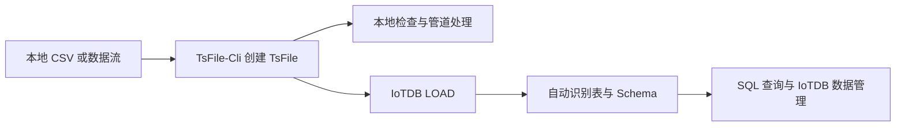

# 早期合并稿｜TsFile-Cli 与 IoTDB 本地闭环

> 归档说明：下文保留早期实跑记录，不作为当前操作指南。统一后的四行示例、业务单位、模块分工和验证规则见[系列目录](https://spricoder.github.io/benchmarking/tsfile-dataset/series/)。当前正文由 00–09 独立文章维护；数据库接入由 TsFile 格式与 IoTDB 工具直接支撑，TsFile-Cli 负责本地文件访问与辅助检查。

> 本文是专栏拆分前的早期合并稿，保留历史链接供检索。最新、可发布版本请从[《玩转时序数据集》系列目录](https://spricoder.github.io/benchmarking/tsfile-dataset/series/)开始；创建和查看见 [01](https://spricoder.github.io/benchmarking/tsfile-dataset/01/) / [02](https://spricoder.github.io/benchmarking/tsfile-dataset/02/)，加载、导出和闭环见 [05](https://spricoder.github.io/benchmarking/tsfile-dataset/05/) / [06](https://spricoder.github.io/benchmarking/tsfile-dataset/06/) / [07](https://spricoder.github.io/benchmarking/tsfile-dataset/07/)。

一份时序数据从本地文件进入数据库，过去经常需要经历这样一条路径：理解文件格式、编写 SDK 程序、定义 schema、逐批写入，再补一套检查逻辑。只要其中一个环节没有固定契约，这条链路就很难复用。

TsFile-Cli 提供了另一种入口：先在本地文件系统中把数据创建为标准 TsFile，并直接检查它的模型、schema、统计和样例行；需要进入数据库时，再由 IoTDB 原生加载这个 TsFile。这样，本地文件和数据库之间共享的不是一份临时脚本，而是同一种时序数据文件格式。

本文用一个完整的本地例子验证这条链路：



核心判断可以先说在前面：**拿到一个合法、模型自洽的 TsFile，意味着数据已经具备进入 IoTDB 的原生载体；但只有 `LOAD` 成功后，才能说它已经进入某个具体的 IoTDB 实例。**

## 1. 这个闭环解决了什么问题

直接把 CSV 导入数据库当然也能完成数据迁移。TsFile-Cli 这条路径的价值不只是“多一次格式转换”，而是让数据在进入数据库之前，先成为一个可独立使用的时序数据产物：

- IoTDB 不启动时，也能在本地查看表、设备、列、统计和数据行；
- shell、`jq`、`awk` 或自动化程序可以通过 CSV、NDJSON、stdout、stderr 和退出码处理它；
- 同一个 TsFile 可以被留存、传递、复查，之后再加载到 IoTDB；
- IoTDB 可以从文件中识别 table model 和 schema，不需要业务程序重新逐列定义并逐行写入。

因此，TsFile-Cli 更像是 TsFile 进入现有工具链的“上匝道”：向左连接本地文件系统与 Unix 工具，向右连接 IoTDB 的原生加载入口。

## 2. 准备本地环境

下面假设已经准备好两个目录：

```bash
TSFILE_SRC=/absolute/path/to/tsfile
IOTDB_DIST=/absolute/path/to/apache-iotdb-2.x-all-bin
DEMO_DIR=$(mktemp -d /tmp/tsfile-cli-iotdb-demo.XXXXXX)

```

其中：

- `TSFILE_SRC` 是 Apache TsFile 源码目录；
- `IOTDB_DIST` 是已经解压的 IoTDB 二进制目录；
- `DEMO_DIR` 用于保存本次演示的 CSV 和 TsFile。

本文实际验证使用的是包含 [TsFile PR 915](https://github.com/apache/tsfile/pull/915) 的 `develop` 代码，以及本地构建的 IoTDB 2.0.7-SNAPSHOT。其他版本应先查看各自的 `--help` 和 `LOAD` 文档，不能直接假设参数完全一致。

| 组件 | 本次实跑基线 |
| --- | --- |
| TsFile-Cli | `2.3.2.dev`，commit `b6ed43c3` |
| IoTDB | `2.0.7-SNAPSHOT`，Build `33a3a30-dev` |

## 3. 构建 TsFile-Cli

进入 TsFile 的 C++ 模块构建：

```bash
cd "$TSFILE_SRC/cpp"
bash build.sh -t=Debug --disable-antlr4

TSFILE_CLI="$TSFILE_SRC/cpp/build/Debug/bin/tsfile-cli"
"$TSFILE_CLI" --version
"$TSFILE_CLI" --help
```

当前命令面包括：

```text
ls schema meta stats count sketch head cat export write
```

如果使用 Maven，也可以在 TsFile 仓库根目录执行：

```bash
./mvnw clean package -P with-cpp
```

对应可执行文件通常位于 `cpp/target/build/bin/tsfile-cli`。运行时还需要让动态链接器找到同一构建产生的 `libtsfile`。

## 4. 从本地 CSV 创建 TsFile

先准备一份机房传感器数据：

```bash
cat > "$DEMO_DIR/sensors.csv" <<'CSV'
time,site,rack,temperature,humidity,status
1725148800000,beijing,rack-a,24.6,46.0,ok
1725148860000,shanghai,rack-b,28.9,68.5,warn
1725148920000,beijing,rack-a,25.1,47.2,ok
1725148980000,shanghai,rack-b,29.4,70.1,warn
CSV
```

这里用 `site` 和 `rack` 标识设备，用三个 FIELD 保存随时间变化的观测值：

```bash
"$TSFILE_CLI" write \
  --table sensors \
  --tag site STRING \
  --tag rack STRING \
  --field temperature DOUBLE \
  --field humidity DOUBLE \
  --field status STRING \
  --input "$DEMO_DIR/sensors.csv" \
  --output "$DEMO_DIR/sensors.tsfile" \
  -v
```

成功时，`write` 返回退出码 `0`，并在 stderr 给出提交后的摘要：

```text
created model=table object=sensors rows=4 output=.../sensors.tsfile
column=site category=TAG data_type=STRING encoding=PLAIN ...
column=temperature category=FIELD data_type=DOUBLE encoding=GORILLA ...
```

这一步不只是把 CSV 换了一个后缀。TsFile-Cli 会检查表头、声明的 TAG/FIELD、数据类型和同一设备内的时间顺序；它先写临时文件，成功关闭后才提交目标文件。若时间戳乱序或某一行类型错误，命令返回非零退出码，并且不会留下可被误认为成功结果的半成品。

## 5. 在文件系统中先完成回读检查

现在还没有连接 IoTDB，但这个文件已经可以独立检查。

先确认模型和对象：

```bash
"$TSFILE_CLI" meta -f csv "$DEMO_DIR/sensors.tsfile"
"$TSFILE_CLI" ls -f csv "$DEMO_DIR/sensors.tsfile"
```

结果表明它是 table-model TsFile，包含 `sensors` 表：

```text
size_bytes,format_version,model
1238,4,table

model,object
table,sensors
```

再查看 schema：

```bash
"$TSFILE_CLI" schema -t sensors -f csv "$DEMO_DIR/sensors.tsfile"
```

```text
model,object,column,category,data_type,encoding,compression
table,sensors,site,TAG,STRING,PLAIN,LZ4
table,sensors,rack,TAG,STRING,PLAIN,LZ4
table,sensors,temperature,FIELD,DOUBLE,GORILLA,LZ4
table,sensors,humidity,FIELD,DOUBLE,GORILLA,LZ4
table,sensors,status,FIELD,STRING,PLAIN,LZ4
```

还可以只读取北京机房的温湿度，并把结果交给下游工具：

```bash
"$TSFILE_CLI" cat -t sensors \
  --tag-filter site eq beijing \
  -m temperature \
  -m humidity \
  -f ndjson \
  "$DEMO_DIR/sensors.tsfile" \
  | jq -s '{rows: length, max_temperature: (map(.temperature) | max)}'
```

```json
{
  "rows": 2,
  "max_temperature": 25.1
}
```

到这里，TsFile 已经进入本地命令行工具链：不写 C++/Java/Python Reader 程序，也能完成检查、筛选、统计和格式交换。

## 6. 启动一个本地 IoTDB 实例

进入已经解压的 IoTDB 目录：

```bash
cd "$IOTDB_DIST"
./sbin/start-standalone.sh
```

默认情况下，IoTDB CLI 连接本机 `127.0.0.1:6667`。先确认 table SQL 方言可用：

```bash
./sbin/start-cli.sh \
  -h 127.0.0.1 -p 6667 \
  -u root -pw root \
  -sql_dialect table \
  -e "show databases"
```

生产环境不应继续使用默认密码；本文只在隔离的本地演示实例中使用默认账户。

## 7. 把本地 TsFile 加载进 IoTDB

先创建一个目标数据库：

```bash
./sbin/start-cli.sh \
  -h 127.0.0.1 -p 6667 \
  -u root -pw root \
  -sql_dialect table \
  -e "create database if not exists tsfile_cli_demo"
```

然后直接加载刚才创建的 TsFile：

```bash
./sbin/start-cli.sh \
  -h 127.0.0.1 -p 6667 \
  -u root -pw root \
  -sql_dialect table \
  -e "load '$DEMO_DIR/sensors.tsfile' with ('database'='tsfile_cli_demo', 'on-success'='none')"
```

这里有三个关键点：

1. `LOAD` 是 IoTDB 的命令，不是 TsFile-Cli 的子命令。TsFile-Cli 负责生成和检查文件，IoTDB 负责把文件纳入实例。
2. table-model TsFile 必须有目标数据库。交互式 CLI 可以先执行 `USE tsfile_cli_demo` 再执行 `LOAD '<path>'`；非交互式脚本更适合像上面一样显式给出 `database`。
3. `on-success=none` 明确保留源 TsFile，便于复查和归档。确认不再需要源文件时，再根据当前 IoTDB 版本的加载参数选择删除策略。

`LOAD` 中的文件路径由 IoTDB 服务端解释。本地单机中，CLI 与服务端共享同一文件系统，所以可以直接使用绝对路径；如果 IoTDB 在远端或集群节点上，必须先让执行加载的服务端能够访问该文件，不能把本机路径当成远端路径。

## 8. 验证表和数据已经进入 IoTDB

查看目标数据库中的表：

```bash
./sbin/start-cli.sh -sql_dialect table \
  -e "show tables from tsfile_cli_demo"
```

本次实跑没有预先执行 `CREATE TABLE`，在实例启用自动建模的前提下，IoTDB 从 TsFile 中识别并创建了 `sensors`：

```text
+---------+-------+
|TableName|TTL(ms)|
+---------+-------+
|  sensors|    INF|
+---------+-------+
```

检查 schema：

```bash
./sbin/start-cli.sh -sql_dialect table \
  -e "describe tsfile_cli_demo.sensors"
```

```text
+-------------+---------+--------+
|   ColumnName| DataType|Category|
+-------------+---------+--------+
|         time|TIMESTAMP|    TIME|
|         site|   STRING|     TAG|
|         rack|   STRING|     TAG|
|  temperature|   DOUBLE|   FIELD|
|     humidity|   DOUBLE|   FIELD|
|       status|   STRING|   FIELD|
+-------------+---------+--------+
```

最后查询数据：

```bash
./sbin/start-cli.sh -sql_dialect table \
  -e "select time, site, rack, temperature, humidity, status
      from tsfile_cli_demo.sensors
      order by time"
```

实际返回 4 行，TAG、FIELD 和数值均与本地 CSV/TsFile 一致。也可以用聚合做一个最小闭环检查：

```bash
./sbin/start-cli.sh -sql_dialect table \
  -e "select count(*) as rows,
             count(temperature) as temperature_points
      from tsfile_cli_demo.sensors"
```

```text
+----+------------------+
|rows|temperature_points|
+----+------------------+
|   4|                 4|
+----+------------------+
```

验证完成后停止本地实例：

```bash
./sbin/stop-standalone.sh
```

## 9. 为什么这意味着“开始进入 IoTDB 生态”

这个例子中真正重要的不是 4 行数据，而是数据身份在不同环境之间保持了连续：

```text
外部数据
  -> 明确的 TAG / FIELD / 类型
  -> 本地原生 TsFile
  -> TsFile-Cli 可检查、可筛选、可传递
  -> IoTDB LOAD 自动识别表结构
  -> IoTDB SQL 可查询、聚合和继续管理
```

如果只有 CSV，它首先是一份通用文本；如何映射为时序模型，仍取决于下一段导入配置。如果已经得到 TsFile，时间轴、设备身份、字段类型和物理编码已经进入 TsFile 的格式契约。IoTDB 不需要业务程序把它重新解释成一串逐行写入请求，而是可以通过原生加载路径承接它。

所以，“拿到 TsFile，就开始进入 IoTDB 生态”是成立的，但它表达的是**可承接性**：数据已经拥有 IoTDB 原生认识的载体。它不表示文件已经自动出现在任意 IoTDB 实例中；实例可见性仍以一次成功的 `LOAD` 和随后的查询验证为准。

## 10. “无缝”不等于“零拷贝”

从使用者角度看，这条链路不需要自写格式转换程序，也不需要预先逐列建表，因而可以称为语义上的无缝衔接。但不应把它宣传为底层文件一定原样挂载或零拷贝。

IoTDB 加载时仍要完成 schema 校验、数据库和分区映射、文件传输，以及必要时的拆分或转换。本次实跑中，原始 `sensors.tsfile` 为 1238 字节；加载到默认含两个 DataRegion 的数据库后，IoTDB 内部形成了两个 TsFile。这说明数据库保证的是数据和 schema 可承接，而不是承诺内部继续保留同一个物理文件。

还应保留以下边界：

- TsFile-Cli 当前每次面向一个本地 TsFile，不连接 IoTDB Server，也不提供 SQL；
- `write` 当前创建新的 table-model TsFile，不负责 tree-model 创建或修改已有文件；
- 本地单机可直接使用共享绝对路径，远端实例必须先解决服务端文件可达性；
- 只有退出码为 `0`，并且 IoTDB 查询回读符合预期时，才算闭环成功；
- 自动建表依赖 IoTDB 启用自动创建 schema；关闭该能力时应先在目标数据库中建立兼容表结构；
- 文件版本、数据类型、加密设置或目标 schema 不兼容时，`LOAD` 仍可能失败，不能把“扩展名是 `.tsfile`”等同于一定可加载。

## 11. 小结

TsFile-Cli 的价值不只是在终端中“看一眼 TsFile”。它把 TsFile 变成了本地文件系统中的标准操作对象：可以创建、检查、筛选、导出，也可以继续交给 IoTDB 原生加载。

这使两类工作方式接在了一起：

- 在数据库之外，数据工程师、shell 工具和 AI 助手围绕一个可验证的本地文件协作；
- 进入数据库之后，同一份时序数据继续获得 IoTDB 的 SQL 查询、聚合和数据管理能力。

因此，更准确的产品表达是：

> **TsFile-Cli 打通了外部数据、本地文件系统与 IoTDB 原生加载链路。数据一旦成为可验证的 TsFile，就已经获得进入 IoTDB 生态的标准入口；一次成功的 `LOAD`，则把这个入口落实为具体实例中的可查询数据。**

---

## 参考资料

- [Apache TsFile PR 915：更新 C++ tsfile-cli 命令面与数据工作流](https://github.com/apache/tsfile/pull/915)
- [Apache TsFile C++ CLI 源码与 README](https://github.com/apache/tsfile/tree/develop/cpp/tools)
- [Apache IoTDB：数据导入](https://iotdb.apache.org/UserGuide/latest/Tools-System/Data-Import-Tool_apache.html)
- [Apache IoTDB：批量加载 TsFile](https://iotdb.apache.org/UserGuide/latest/Basic-Concept/Write-Data_apache.html)
- [Apache IoTDB：Table Model 表管理](https://iotdb.apache.org/UserGuide/latest-Table/Basic-Concept/Table-Management_apache.html)
